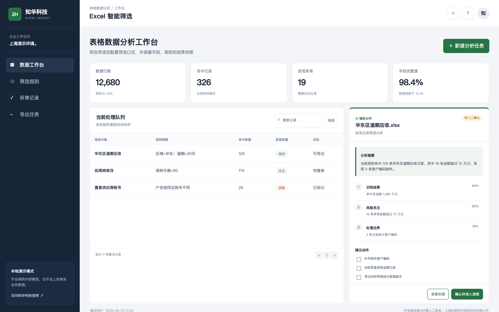

[简体中文](README.md) | **English**

## 2026-10-23: Typed table quality profiling

This update implements **Typed table quality profiling** on the backend, with structured input, explicit validation, evidence or exception details, and a responsive utility page at `/practical.html`. Results are computed from submitted data, not fixed demo responses.

The new endpoint is disabled (503) until the administrator sets an independent 32–256 printable ASCII character ZHUATECH_PRACTICAL_TOKEN. Enter it in the utility page; it is kept only in page memory, never embedded in source or browser storage. Use `POST /api/practical/typed-table-profile`. No external model invocation or business posting occurs. See [algorithm, sample, boundaries and test commands](docs/AI_MULTIMODAL_UPGRADE_20261023.md).

# ZhuaTech Excel Insight

> A source-available enterprise project by [ZhuaTech](https://www.zhuatech.cn/) for enterprise data, knowledge, search, analytics, and AI operations.

ZhuaTech Excel Insight provides a practical, self-hosted foundation for enterprise data, knowledge, search, analytics, and AI operations. It is designed for data teams, knowledge owners, AI teams, analysts, and business users, with clear business records, controlled workflows, operational visibility, and auditable actions.

This repository is intended for learning, technical evaluation, and non-commercial collaboration. The included implementation, tests, database resources, and container configuration provide a reproducible starting point for further enterprise adaptation.

**Search topics:** enterprise excelinsight, self-hosted excelinsight, Java Spring Boot enterprise software, digital transformation.

## Solution Overview

- **Primary users:** Data teams, knowledge owners, AI teams, analysts, and business users.
- **Deployment model:** Self-hosted, with container-based local deployment where supported.
- **Governance baseline:** Role-aware operations, validation, approval boundaries, exception handling, and auditability.
- **Production boundary:** Review security, identity, backup, observability, capacity, and compliance controls before production use.

## Business Coverage

- **Excel Insight Task** — Manage excel insight task with ownership, validation, and explicit lifecycle states.
- **Analysis Task** — Coordinate analysis task through controlled workflows and approval gates.
- **Audit Log** — Track audit log metrics, exceptions, deadlines, and follow-up actions.
- **Governed data and knowledge sources** — Preserve governed data and knowledge sources evidence in searchable, traceable operational history.
- **Search, analysis, or model workflows** — Expose search, analysis, or model workflows in role-aware user and administration workspaces.
- **Quality and evaluation controls** — Connect quality and evaluation controls to external systems through configurable integration boundaries.

## Implementation Stack

**Technology stack:** Java 21 · Spring Boot · Responsive HTML5 · MySQL 8 · Docker Compose

### Repository Layout

- `backend/` — Java backend, domain services, APIs, validation, and automated tests
- `frontend/` — responsive user and administration interfaces
- `database/` — database schema, migrations, or demonstration data
- `deploy/` — deployment and operations resources
- `docs/` — architecture, operations, screenshots, and supporting documentation
- `compose.yaml` — local multi-service orchestration

## Local Deployment

```bash
docker compose up -d --build
```

- Review `compose.yaml` before changing published ports, storage paths, or production credentials.

## Verification

Run the checks supported by this repository before changing or deploying it:

```bash
cd backend && mvn test
```

## Interface Preview

### Excelinsight Dashboard



## Security and Production Readiness

- Never commit real passwords, API keys, tokens, certificates, customer data, or production connection strings.
- Replace all local demonstration credentials and secrets before deployment.
- Apply least privilege, tenant isolation, backup and restore drills, monitoring, rate limiting, and vulnerability management.
- Please report security issues privately through the contact channels below instead of publishing sensitive details.

## Usage and Commercial Licensing

Copyright © 2026 Shanghai Rujing Zhihua Information Technology Co., Ltd.

This project is a publicly available source edition intended solely for personal learning, technical research, and non-commercial communication. Commercial use, paid delivery, resale, hosted commercial services, and commercial derivative distribution require prior written authorization from the copyright holder.

Third-party dependencies remain subject to their respective licenses. Review the repository `LICENSE` and `NOTICE` files before use.

## Commercial Licensing and Enterprise Services

For commercial licensing, private deployment, enterprise customization, software outsourcing, implementation services, FDE outsourcing, OPC technical support, or AI transformation consulting, contact ZhuaTech:

- Email: [han@zhuatech.cn](mailto:han@zhuatech.cn)
- Email: [jack@zhuatech.cn](mailto:jack@zhuatech.cn)
- [WhatsApp: +86 17521234993](https://wa.me/8617521234993)
- Website: [https://www.zhuatech.cn/](https://www.zhuatech.cn/)

## About ZhuaTech

[ZhuaTech](https://www.zhuatech.cn/) is operated by Shanghai Rujing Zhihua Information Technology Co., Ltd. We support small and medium-sized enterprises with digital transformation, AI adoption, enterprise software implementation, custom development, software project outsourcing, FDE services, OPC integration, and long-term technical support.
